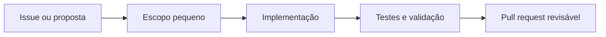

# Contribuindo com o VOID AI

> O VOID é um núcleo Kotlin/JVM Android-first em construção. Hoje ele cria **propostas revisáveis**; não é um aplicativo Android pronto, servidor, agente com conectores ou executor de ferramentas.

Obrigado por ajudar a construir isso do jeito certo: mudanças pequenas, evidência verificável e controle antes de automação.

## Onde sua contribuição ajuda mais

| Prioridade | Exemplos úteis |
| --- | --- |
| **Alta** | Testes de contratos, estados e transições |
| **Alta** | Reprodução de build e Gradle Wrapper |
| **Alta** | Revisão de segurança e dados sensíveis |
| Média | Coerência Kotlin, JSON Schema e OpenAPI |
| Média | Documentação clara em português e inglês |
| Depois | Interface Android ligada ao fluxo simulado |

Antes de propor uma integração, conector ou framework multiagente, compare com uma solução mais simples e explique o ganho verificável.

## O fluxo de uma boa mudança



### 1. Comece pelo problema

Para mudanças médias ou grandes, abra uma [issue](https://github.com/wandersonsaint014-hue/VOID-IA-public/issues) antes. Explique:

- **problema:** o que está incorreto, ausente ou difícil hoje;
- **benefício:** qual resultado concreto a mudança traz;
- **escopo:** arquivos, contratos ou estados que podem mudar;
- **riscos:** segurança, privacidade, compatibilidade e manutenção;
- **validação:** quais testes ou verificações demonstram que funcionou;
- **fora de escopo:** o que a mudança deliberadamente não tenta resolver.

Para correções pequenas de documentação, typo ou link, pode abrir o pull request diretamente.

### 2. Mantenha o escopo pequeno

- Crie um fork e uma branch descritiva, por exemplo: `docs/clarify-contracts`.
- Faça uma alteração focada por pull request.
- Evite misturar refatoração ampla, novas dependências e mudança de comportamento no mesmo PR.
- Atualize contratos e testes quando uma mudança altera comportamento público.
- Não declare uma funcionalidade como pronta se ela for apenas prevista no roadmap.

## Verificações antes do pull request

O workflow oficial usa **JDK 17** e **Gradle 8.14.4**. Ainda não há Gradle Wrapper no repositório.

```bash
git clone https://github.com/<seu-usuario>/VOID-IA-public.git
cd VOID-IA-public

gradle :core:test --no-daemon --console=plain

python3 -m venv .schema-venv
.schema-venv/bin/python -m pip install --disable-pip-version-check jsonschema referencing
.schema-venv/bin/python scripts/verify_schemas.py
```

Se não conseguir executar alguma verificação, informe isso claramente no pull request, com o motivo. Nunca apresente testes não executados como aprovados.

A CI executa testes do núcleo e validação offline dos schemas. Consulte o [workflow de verificação](.github/workflows/verify.yml) e os resultados em [Actions](https://github.com/wandersonsaint014-hue/VOID-IA-public/actions).

## Checklist do pull request

Copie e preencha este bloco na descrição do PR:

```md
## O que mudou
- 

## Por que mudou
- 

## Contratos e estados afetados
- [ ] Nenhum
- [ ] Kotlin
- [ ] JSON Schema
- [ ] OpenAPI
- [ ] Documentação

## Validação
- [ ] `gradle :core:test --no-daemon --console=plain`
- [ ] `python scripts/verify_schemas.py` em ambiente com dependências instaladas
- [ ] Não executei tudo, expliquei abaixo

## Riscos e limites
- 

## Fora de escopo
- 
```

## Regras de segurança

O projeto ainda não executa ferramentas. Preserve esse limite até que a infraestrutura e os testes da fase correspondente existam.

- Não adicione `ToolRunner`, conectores reais ou efeitos externos sem decisão explícita, controles verificáveis e cobertura de teste.
- O `PolicyGate` deve continuar negando por padrão. Uma aprovação futura não poderá superar uma negativa da política.
- Campos enviados pelo cliente, como `user_id`, `caller`, `approver_id` ou `permissions`, **não** concedem autoridade.
- Não inclua tokens, senhas, cookies, dados pessoais, chaves ou arquivos locais em commits, issues, testes ou logs.
- Trate respostas de modelos e conteúdo externo como dados não confiáveis.
- Evite registrar dados sensíveis em auditoria. Novas persistências precisam prever redação e controle de acesso.

Leia [SECURITY.md](SECURITY.md) e a [revisão de segurança](docs/SECURITY_REVIEW.md) antes de mexer em autorização, auditoria, dados ou integração externa.

## Contratos e compatibilidade

Se a mudança tocar modelos, serialização ou schemas:

- mantenha `snake_case`, enums em minúsculas e instantes ISO-8601;
- rejeite campos desconhecidos e dados obrigatórios vazios;
- atualize modelo Kotlin, schema JSON e testes em conjunto quando aplicável;
- preserve IDs e campos públicos existentes ou documente a quebra de compatibilidade;
- mantenha referências de schema locais e verificáveis offline.

Veja os detalhes em [docs/CONTRACTS.md](docs/CONTRACTS.md).

## Comunicação e revisão

- Escreva commits e descrições de forma direta, explicando a intenção.
- Prefira exemplos pequenos e dados fictícios.
- Responda comentários com evidência: teste, contrato, link de documentação ou decisão explícita.
- Discordar é normal; mantenha a discussão técnica, respeitosa e focada na segurança e manutenção do projeto.

## Licença, autoria e divulgação

O projeto usa a [licença MIT](LICENSE). Ao contribuir, confirme que tem os direitos necessários e disponibilize sua alteração sob a licença do projeto. Preserve avisos de copyright e informe a origem e licença de qualquer dependência ou código de terceiros.

Ao compartilhar o VOID, apresente-o como um núcleo em desenvolvimento, não como produto pronto ou solução certificada. Evite divulgação em massa, comentários promocionais em issues alheias e badges de aprovação que o projeto não recebeu.

Obrigado por ajudar o VOID a crescer com mais clareza do que pressa.
