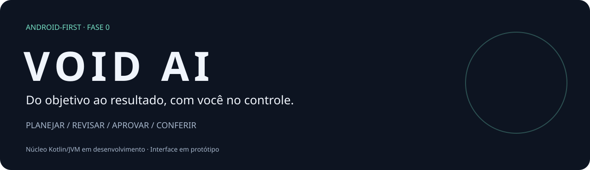
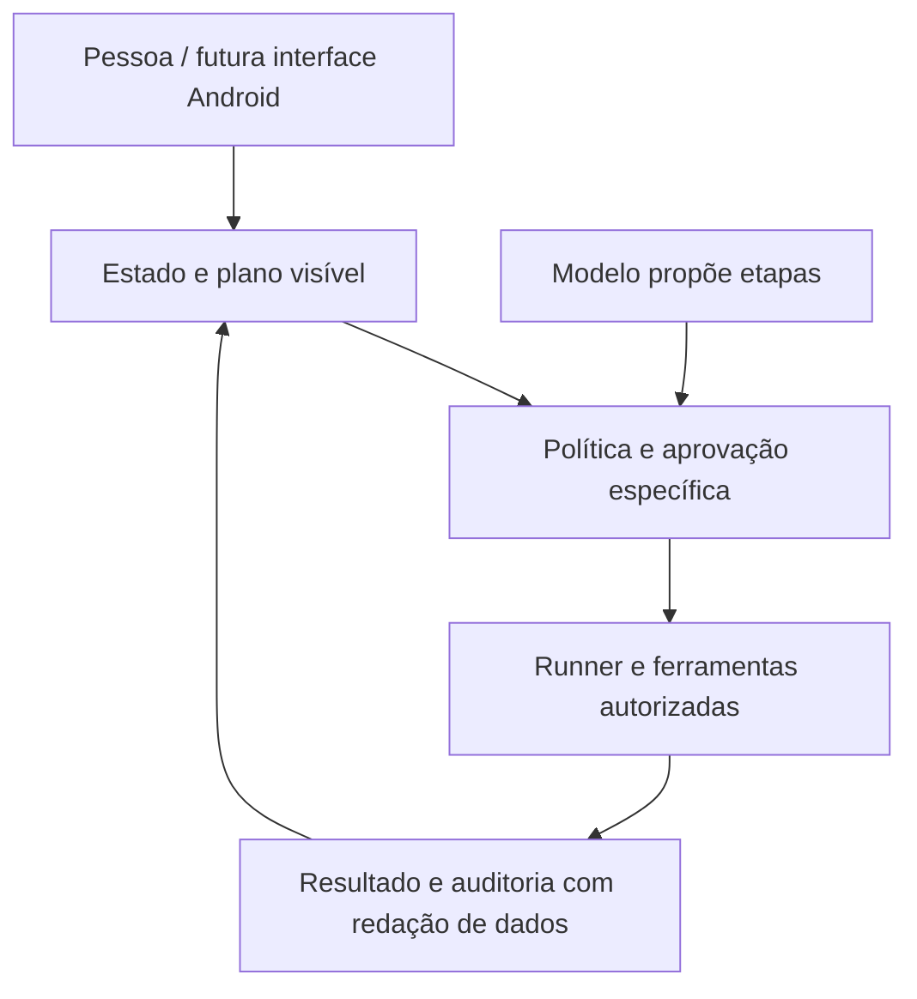

<p align="center"></p>

<p align="center"><strong>Inteligência operacional pensada primeiro para Android.</strong><br>Um objetivo claro. Um plano visível. Ações sob seu controle.</p>

<p align="center"><a href="LICENSE"></a>   <a href="https://github.com/wandersonsaint014-hue/VOID-IA-public/actions/workflows/verify.yml"></a></p>

> **Transparência primeiro:** este repositório contém modelos, interfaces e contratos de um núcleo Kotlin/JVM em desenvolvimento. As telas e a demo são protótipos separados. Ainda não há aplicativo Android instalável, servidor implementado ou execução real de agentes/conectores.

## A ideia

O VOID AI quer transformar pedidos em planos compreensíveis e, futuramente, em ações verificáveis. A pessoa precisa entender o que será feito, decidir sobre ações sensíveis e conferir o resultado.

- **Planejar antes de executar:** etapas, destinos e limites à vista.
- **Manter a pessoa no controle:** aprovação específica para operações sensíveis.
- **Mostrar o que aconteceu:** sucesso, falha, cancelamento e efeito incerto sem esconder diferenças.
- **Começar simples:** núcleo Kotlin/JVM e direção Android-first; agentes adicionais só quando houver ganho demonstrável.

Esses pontos são a direção do produto, não garantias implementadas no runtime.

## A interface

Mantemos a proposta visual: fundo escuro, acentos verde-menta, cartões legíveis e uma ação principal por etapa. O fluxo continua **início → plano → aprovação → execução → resultado → histórico**.


- [Experimentar a demo navegável](https://pages.toqi.life/p/e55hzqwsn3cea6x5jateokml74)
- [Conhecer as seis telas e regras da interface](docs/INTERFACE.md)

A demo usa dados fictícios, não conecta contas e não envia mensagens. Recarregar apaga a sessão. O teste isolado da lógica passou na preparação anterior; o teste completo de navegador não concluiu. Isso não valida Kotlin nem integração Android.

## O que existe hoje

| Área | Situação |
| --- | --- |
| Modelos e interfaces Kotlin/JVM | No repositório |
| Serialização e testes de contratos | No repositório |
| Schemas JSON e OpenAPI | No repositório |
| Workflow de verificação | Configurado; confira Actions |
| Telas e demo HTML | Protótipo separado |
| App Android e servidor | Não implementados |
| Runner, aprovação e conectores reais | Não implementados |

Campos de permissões, risco e idempotência não provam autorização em execução. Consulte [contratos](docs/CONTRACTS.md) e [riscos conhecidos](docs/SECURITY_REVIEW.md).

## Comece por aqui

1. Explore a [interface preservada](docs/INTERFACE.md).
2. Leia a [revisão da ideia e pesquisa técnica](docs/RESEARCH.md).
3. Confira o [roadmap com critérios de entrega](docs/ROADMAP.md).

### Trabalhar no núcleo

Requer **JDK 17** e **Gradle 8.14.4** instalado, alinhado ao workflow atual. Ainda não há Gradle Wrapper. A primeira execução pode baixar dependências.

```bash
git clone https://github.com/wandersonsaint014-hue/VOID-IA-public.git
cd VOID-IA-public
gradle :core:test --no-daemon --console=plain
```

Para verificar schemas, siga o [workflow existente](.github/workflows/verify.yml). Não há instalação automática de aplicativo disponível. Esta revisão de apresentação não executou novamente o build Kotlin; confira os resultados reais em [Actions](https://github.com/wandersonsaint014-hue/VOID-IA-public/actions).

## Arquitetura pretendida



**Direção futura:** o modelo propõe; o código deverá validar identidade, argumentos, destino, permissões e limites antes de efeitos externos. Essas garantias ainda precisam de implementação e testes.

## Navegue pelo projeto

- [`core/`](core/): modelos, interfaces, serialização e testes.
- [`schemas/`](schemas/): contratos JSON.
- [`Openapi.Yaml`](Openapi.Yaml): especificação, não serviço ativo.
- [Interface](docs/INTERFACE.md), [pesquisa](docs/RESEARCH.md) e [roadmap](docs/ROADMAP.md).
- [Origem e histórico](docs/PROVENANCE.md).

## Construir junto

As contribuições mais úteis agora são testes de contratos, revisão de segurança, máquina de estados e acessibilidade da futura interface. Leia [como contribuir](CONTRIBUTING.md).

Use as [issues](https://github.com/wandersonsaint014-hue/VOID-IA-public/issues) para discutir problema, proposta, riscos e critérios de validação. Não publique credenciais ou dados pessoais.

## Licença e origem

[MIT](LICENSE), copyright original preservado. A origem da cópia pública e os limites do histórico estão em [PROVENANCE](docs/PROVENANCE.md). Dependências mantêm suas licenças. Não há transferência de autoria nem certificação de segurança.
