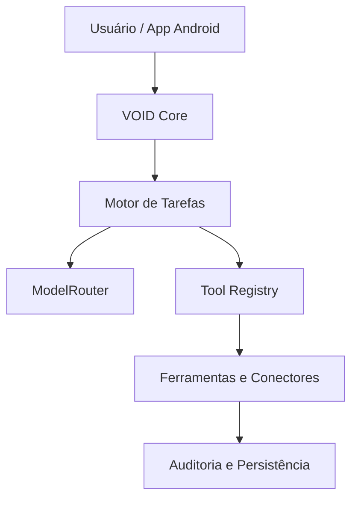

# VOID AI

Plataforma de inteligência operacional Android-first, em fase 0: especificações e contratos do núcleo Kotlin. Ainda não inclui aplicativo Android, servidor ou implementação completa dos agentes.

## Arquitetura planejada

## Estrutura

- `core/`: modelos e interfaces Kotlin/JVM.
- `schemas/`: contratos JSON.
- `Openapi.Yaml`: especificação da API, não um servidor em execução.
- `docs/PROVENANCE.md`: origem, commits e licença.

## Compilação

Requer JDK 17 e Gradle 8.5 instalado. Na raiz, execute `gradle :core:test`. Não há Gradle Wrapper incluído. A compilação precisa ser validada antes de distribuir o projeto.

## Commits e licença

Cópia pública do snapshot `fd7198c806a78ab2fb54b91107b3805d8069904f` do VOID-IA-. O histórico privado anterior não foi importado. Os commits públicos registram importação e correções, não transferem autoria e não representam assinatura verificada.

Licença [MIT](LICENSE). Copyright (c) 2026 wandersonsaint014-hue, preservado. Dependências têm licenças próprias. Veja [a origem e os cuidados](docs/PROVENANCE.md).
