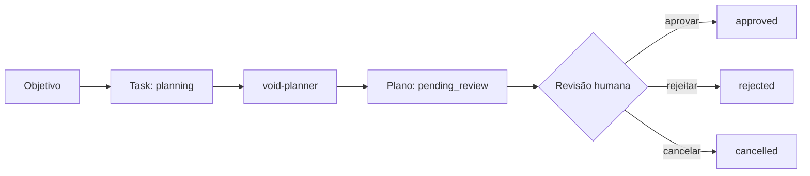

# VOID AI

<p align="center">
  <strong>Planejamento de IA com revisão humana, contratos claros e execução fora de cena.</strong>
</p>

<p align="center">
  <a href="https://github.com/wandersonsaint014-hue/VOID-IA-public/actions/workflows/verify.yml"></a>
  <a href="LICENSE"></a>
  
  
</p>

<p align="center">
  <a href="https://pages.toqi.life/p/e55hzqwsn3cea6x5jateokml74">Ver demo</a> ·
  <a href="docs/CONTRACTS.md">Contratos</a> ·
  <a href="docs/ROADMAP.md">Roadmap</a> ·
  <a href="CONTRIBUTING.md">Contribuir</a> ·
  <a href="https://github.com/wandersonsaint014-hue/VOID-IA-public/actions">Ver CI</a>
</p>

> **Estado atual:** o VOID é um núcleo Kotlin/JVM Android-first que transforma uma tarefa em uma **proposta revisável**. Ele não é um aplicativo Android, servidor ou assistente com conectores reais. Não há execução automática de ferramentas.

## Por que existe

O VOID parte de uma premissa simples: antes de uma IA agir, a pessoa precisa entender **o que foi proposto**, **por que**, **com quais limites** e **qual é o estado daquela decisão**.

Hoje, o agente `void-planner` recebe uma tarefa e cria um plano persistível para revisão. O foco desta fase é deixar o fluxo seguro, explícito e testável antes de adicionar integrações externas.

| Hoje no núcleo | Não existe ainda |
| --- | --- |
| Propostas de plano revisáveis | App Android instalável |
| Estados e transições explícitos | Servidor ou API ativa |
| Contratos Kotlin, JSON e OpenAPI | Runner de ferramentas |
| PolicyGate com negação por padrão | Autorização verificável |
| Auditoria de proposta | Contas e conectores reais |

## O fluxo, sem atalhos



`approved` encerra a revisão da proposta. **Não executa nada**, não concede permissões e não substitui uma política de segurança.

### Estados modelados

| Entidade | Fluxo permitido |
| --- | --- |
| `Task` | `planning` → `pending_review` → `approved` / `rejected` / `cancelled` |
| `Plan` | `pending_review` → `approved` / `rejected` / `cancelled` |
| `Step` | `pending_review` → `approved` / `rejected` / `cancelled` |

Estados terminais não voltam automaticamente. Uma alteração posterior precisa gerar uma nova proposta identificável e auditável.

## Proteções já assumidas

- **Planejar não é executar:** o planejador não chama ferramentas.
- **Negação por padrão:** o `PolicyGate` avalia pedidos e não autoriza efeitos externos.
- **Dados do cliente não dão poder:** `user_id`, `caller` e `permissions` são dados não confiáveis, não provas de identidade.
- **Contratos estritos:** JSON usa `snake_case`, enums em minúsculas, datas ISO-8601 e rejeita campos desconhecidos.
- **Auditoria com cuidado:** futuras auditorias precisam redigir segredos e dados pessoais antes de persistir.

Leia os detalhes em [Contratos](docs/CONTRACTS.md) e a lista franca de limites em [Revisão de segurança](docs/SECURITY_REVIEW.md).

## Explorar a interface

A demo mostra a direção da experiência: fundo escuro, acentos verde-menta, plano legível e uma decisão principal por etapa.

**Início → plano → revisão → resultado → histórico**

[**Abrir a demo navegável**](https://pages.toqi.life/p/e55hzqwsn3cea6x5jateokml74)

A demo usa dados fictícios, não conecta contas e não envia mensagens. Ela é uma demonstração de fluxo e interface, não uma integração Android validada.

## Estrutura do repositório

```text
core/                 Núcleo Kotlin/JVM, modelos, planejador e testes
schemas/              Contratos JSON Schema Draft-07
scripts/              Verificações locais de contratos
docs/                 Segurança, interface, pesquisa, contratos e roadmap
Openapi.Yaml          Referência de API futura, sem serviço ativo
.github/workflows/    Verificação de testes e schemas no GitHub Actions
```

## Rodar as verificações

**Requisitos**

- JDK 17
- Gradle 8.14.4
- Python 3 para verificar os schemas

> Ainda não existe Gradle Wrapper. O workflow oficial configura Gradle 8.14.4 e JDK 17 antes de testar.

```bash
git clone https://github.com/wandersonsaint014-hue/VOID-IA-public.git
cd VOID-IA-public

gradle :core:test --no-daemon --console=plain

python3 -m venv .schema-venv
.schema-venv/bin/python -m pip install --disable-pip-version-check jsonschema referencing
.schema-venv/bin/python scripts/verify_schemas.py
```

A CI executa essas duas verificações em `push`, pull request e acionamento manual. Consulte [Actions](https://github.com/wandersonsaint014-hue/VOID-IA-public/actions) para o resultado do commit que você está avaliando.

## Próximos passos reais

A direção não é colocar conectores na frente do controle. O caminho é:

1. Tornar a base reproduzível com Gradle Wrapper.
2. Implementar aprovações verificáveis, ligadas à identidade autenticada, ação, argumentos normalizados, destino e expiração.
3. Modelar falha confirmada, efeito incerto e cancelamento.
4. Usar ferramentas **simuladas** atrás da política antes de qualquer conta real.
5. Criar a interface Android conectada primeiro ao fluxo simulado.

O detalhamento e os critérios de conclusão estão no [roadmap](docs/ROADMAP.md).

## Contribuir

Contribuições úteis agora incluem:

- testes de estados e transições;
- validação de contratos Kotlin, JSON e OpenAPI;
- revisão de segurança e tratamento de dados;
- acessibilidade e clareza da futura interface Android.

Leia o [guia de contribuição](CONTRIBUTING.md) e abra uma [issue](https://github.com/wandersonsaint014-hue/VOID-IA-public/issues) com problema, benefício, risco e critério de validação. Nunca inclua credenciais ou dados pessoais em issues, logs ou exemplos.

## Licença e procedência

Distribuído sob a [licença MIT](LICENSE), com autoria original preservada. Consulte [PROVENANCE](docs/PROVENANCE.md) para conhecer a procedência da cópia pública e seus limites.
