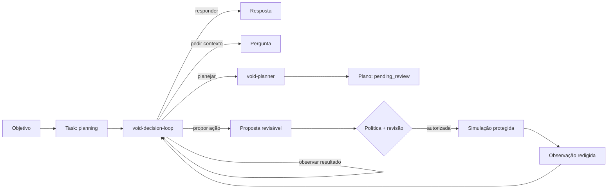

# VOID AI

<p align="center">
  <strong>Um agente de IA local-first, Android-first, que pensa antes de agir.</strong>
</p>

<p align="center">
  <a href="https://github.com/wandersonsaint014-hue/VOID-IA-public/actions/workflows/verify.yml"></a>
  <a href="LICENSE"></a>
  
  
</p>

<p align="center">
  <a href="https://pages.toqi.life/p/e55hzqwsn3cea6x5jateokml74">Demo</a> ·
  <a href="docs/AGENT_LOOP.md">Loop do agente</a> ·
  <a href="docs/CONTRACTS.md">Contratos</a> ·
  <a href="docs/ROADMAP.md">Roadmap</a> ·
  <a href="CONTRIBUTING.md">Contribuir</a>
</p>

> **Estado do projeto:** o VOID é um núcleo Kotlin/JVM em construção, não um app Android, servidor ou assistente conectado a contas. Já decide o próximo passo, cria planos e propostas revisáveis e testa efeitos somente em simulação protegida.

## O que é o VOID

O VOID foi pensado como um **agente de IA**, não como um chat com botões de aprovação. Ele recebe um objetivo, interpreta o contexto disponível, escolhe um próximo passo estruturado, planeja quando necessário, aprende com observações e explica o resultado.

Segurança não substitui essa agência. Política, revisão e autorização existem para governar **como** o agente pode agir quando uma decisão pode produzir efeito. Hoje, essa fronteira termina em ferramentas simuladas: nenhuma conta é conectada, nenhuma mensagem é enviada e nenhum efeito externo é produzido.

## O núcleo em uma olhada

| Componente | Faz hoje | Não faz |
| --- | --- | --- |
| `void-decision-loop` | Decide o próximo passo | Chamar ferramenta |
| `void-planner` | Cria plano revisável | Executar etapas |
| Proposta de ação | Liga intenção a capacidade | Dar autorização |
| Política e revisão | Avaliam a proposta | Executar efeito |
| Runtime protegido | Simula ferramenta permitida | Tocar serviço real |

**Ainda não existe:** aplicativo Android instalável, memória persistente, checkpoints após reinício, autenticação de produção, API ativa, conectores, contas ou execução fora da simulação.

## Como o agente opera



O loop trabalha com decisões validadas, não com comandos livres de modelo:

- responder ou pedir esclarecimento;
- propor um plano revisável;
- propor uma ação para análise separada;
- aguardar revisão;
- registrar uma observação, concluir ou falhar de modo controlado.

Uma decisão de propor ação **não** cria permissão. Ela ainda exige principal verificado, capacidade permitida, política atual, revisão humana e autorização vinculada antes da simulação.

## Princípios que não mudam

- **Objetivo antes de automação:** o agente deve entender e decidir, não apenas disparar fluxos.
- **Local-first por direção:** o núcleo foi desenhado para evoluir em Android, reduzindo dependência desnecessária de serviços externos.
- **Decisão não é autoridade:** modelo, cliente e campos declarados não concedem poder operacional.
- **Negação por padrão:** uma política negativa encerra a possibilidade de simulação.
- **Proposta não é execução:** aprovação de plano ou ação nunca dispara uma ferramenta sozinha.
- **Evidência mínima:** auditoria deve guardar apenas o necessário e redigir dados sensíveis.
- **Contrato antes de conector:** validação, limites, revogação, recuperação e idempotência vêm antes de qualquer conta real.

## Limites atuais, sem maquiagem

O repositório publica uma fundação deliberadamente pequena. O `DecisionLoopAgent` tem limite de iterações, rejeita metadados inválidos e interrompe observações repetidas. A primeira execução só aceita `SimulatedTool` pelo `GuardedSimulationRunner`.

Há lacunas importantes antes de ampliar autonomia:

- memória contextual e checkpoints duráveis;
- persistência transacional de revisão e autorização;
- cancelamento, timeout, orçamento, concorrência e recuperação;
- autenticação concreta e revogação persistente;
- interface Android conectada ao fluxo simulado;
- qualquer integração, conta ou efeito externo.

Leia a [revisão de segurança](docs/SECURITY_REVIEW.md) para os riscos abertos e a [documentação do runtime simulado](docs/SIMULATION_RUNTIME.md) para as fronteiras técnicas.

## Demo de experiência

A [demo navegável](https://pages.toqi.life/p/e55hzqwsn3cea6x5jateokml74) mostra a direção do produto: fluxo curto, uma decisão principal por etapa, histórico legível e foco no que o agente vai fazer antes de fazê-lo.

Ela usa dados fictícios. É referência de produto e interface, não uma integração Android validada.

## Estrutura

```text
core/                 Núcleo Kotlin/JVM, modelos, agente e testes
schemas/              Contratos JSON Schema Draft-07
scripts/              Verificações locais de contratos
docs/                 Arquitetura, segurança, contratos e roadmap
Openapi.Yaml          Referência de API futura; não há serviço ativo
.github/workflows/    Verificações no GitHub Actions
```

## Rodar as verificações

**Requisitos:** JDK 17, Gradle 8.14.4 e Python 3.

> O repositório ainda não inclui Gradle Wrapper. A CI configura JDK 17 e Gradle 8.14.4 para validar cada alteração.

```bash
git clone https://github.com/wandersonsaint014-hue/VOID-IA-public.git
cd VOID-IA-public

gradle :core:test --no-daemon --console=plain
python3 scripts/verify_schemas.py
```

A CI roda os testes Kotlin e a validação offline dos schemas em push, pull request e execução manual. Confira o resultado específico em [GitHub Actions](https://github.com/wandersonsaint014-hue/VOID-IA-public/actions).

## Próximo passo técnico

A prioridade é tornar a base reproduzível com Gradle Wrapper e, depois, persistir a simulação com consumo único, expiração, revogação e recuperação após reinício. Só então o projeto avança para a interface Android e, muito mais à frente, para uma integração real pequena e reversível.

O plano de entrega completo está no [roadmap](docs/ROADMAP.md).

## Contribuir

Contribuições úteis agora:

- testes de estados, transições e falhas seguras;
- validação de contratos Kotlin, JSON Schema e OpenAPI;
- revisão de segurança, privacidade e auditoria;
- clareza, acessibilidade e desenho da futura interface Android.

Leia o [guia de contribuição](CONTRIBUTING.md) antes de abrir uma issue ou pull request. Não inclua credenciais, dados pessoais ou conteúdo sensível em código, logs, exemplos ou discussões públicas.

## Licença e procedência

Distribuído sob a [licença MIT](LICENSE), com autoria original preservada. Consulte [PROVENANCE](docs/PROVENANCE.md) para a procedência da cópia pública e seus limites.
