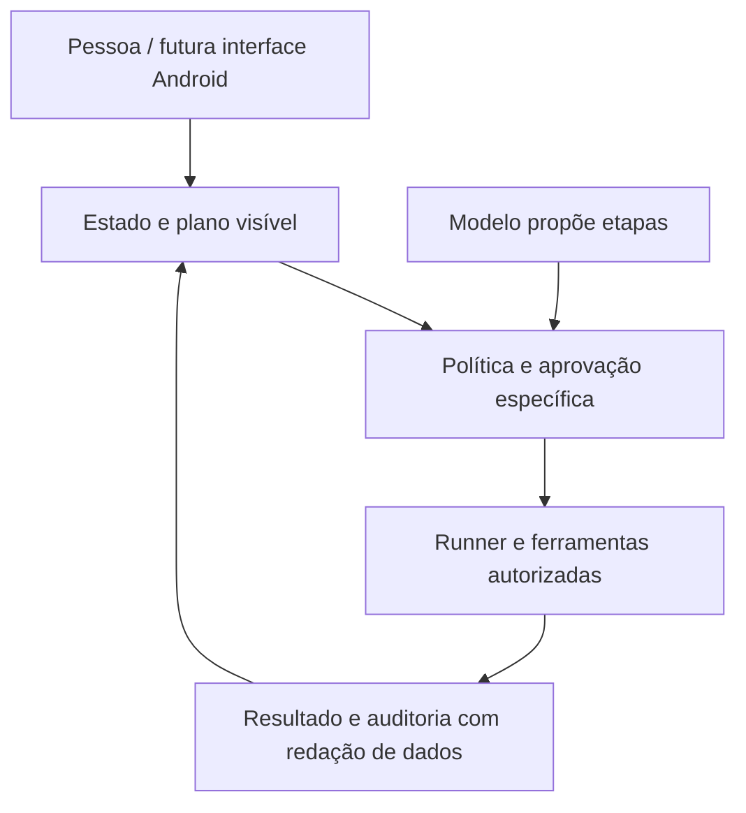

# VOID AI

**Inteligência operacional pensada primeiro para Android.**

Um objetivo claro. Um plano visível. Ações sob seu controle.

[Explorar a demo](https://pages.toqi.life/p/e55hzqwsn3cea6x5jateokml74) · [Roadmap](docs/ROADMAP.md) · [Contribuir](CONTRIBUTING.md) · [Verificações](https://github.com/wandersonsaint014-hue/VOID-IA-public/actions)

> **Em desenvolvimento:** este repositório reúne o núcleo Kotlin/JVM, modelos, interfaces e contratos. A demo é um protótipo separado. Ainda não há aplicativo Android instalável, servidor ou agentes e conectores reais em execução.

## A ideia

Transformar pedidos em planos compreensíveis e, futuramente, em ações verificáveis. A pessoa acompanha as etapas, decide sobre operações sensíveis e confere o resultado.

- **Planejar antes de executar:** etapas e limites à vista.
- **Manter a pessoa no controle:** aprovação específica para ações sensíveis.
- **Mostrar o resultado:** distinguir sucesso, falha, cancelamento e efeito incerto.
- **Começar simples:** núcleo Kotlin/JVM, direção Android-first e expansão com ganho demonstrável.

Esses princípios orientam o produto; não representam garantias já implementadas no runtime.

## Explore a interface

Fundo escuro, acentos verde-menta, cartões legíveis e uma ação principal por etapa.

**Início → plano → aprovação → execução → resultado → histórico**

- [Experimentar a demo navegável](https://pages.toqi.life/p/e55hzqwsn3cea6x5jateokml74)
- [Conhecer as seis telas e as regras da interface](docs/INTERFACE.md)

A demo usa dados fictícios, não conecta contas nem envia mensagens. A sessão é apagada ao recarregar. É uma demonstração de interface, não uma integração Android validada.

## O que existe hoje

| Área | Estado |
| --- | --- |
| Núcleo Kotlin/JVM | Modelos e interfaces |
| Serialização | Testes de contratos |
| JSON e OpenAPI | Contratos e especificação |
| Verificação automatizada | Workflow no GitHub Actions |
| Interface e demo | Protótipo separado |
| App Android e servidor | Não implementados |
| Runner e conectores reais | Não implementados |

Campos de permissões, risco e idempotência não equivalem a autorização em execução. Veja os [contratos](docs/CONTRACTS.md) e a [revisão de segurança](docs/SECURITY_REVIEW.md).

## Comece pelo núcleo

Requisitos: **JDK 17** e **Gradle 8.14.4** instalado, conforme o workflow atual. Ainda não há Gradle Wrapper; a primeira execução pode baixar dependências.

```bash
git clone https://github.com/wandersonsaint014-hue/VOID-IA-public.git
cd VOID-IA-public
gradle :core:test --no-daemon --console=plain
```

A validação de schemas está descrita no [workflow de verificação](.github/workflows/verify.yml). Consulte as execuções e a revisão correspondente em [Actions](https://github.com/wandersonsaint014-hue/VOID-IA-public/actions); um resultado de CI não valida o aplicativo Android. Não há instalação automática de aplicativo disponível.

## Arquitetura pretendida



O modelo propõe; o código deverá validar identidade, argumentos, destino, permissões e limites antes de efeitos externos. Essa camada ainda precisa de implementação e testes.

## Guia do repositório

- [`core/`](core/): modelos, interfaces, serialização e testes.
- [`schemas/`](schemas/): contratos JSON.
- [`Openapi.Yaml`](Openapi.Yaml): especificação de API, não serviço ativo.
- [Interface](docs/INTERFACE.md): telas e fluxo de navegação.
- [Pesquisa](docs/RESEARCH.md): revisão da ideia e referências técnicas.
- [Roadmap](docs/ROADMAP.md): prioridades e critérios de entrega.
- [Origem e histórico](docs/PROVENANCE.md): procedência da cópia pública.

## Construir junto

As contribuições mais úteis agora são testes de contratos, revisão de segurança, máquina de estados e acessibilidade da futura interface. Leia [como contribuir](CONTRIBUTING.md).

Use as [issues](https://github.com/wandersonsaint014-hue/VOID-IA-public/issues) para apresentar problema, proposta, riscos e critérios de validação. Não publique credenciais nem dados pessoais.

## Licença e origem

[MIT](LICENSE), com copyright original preservado. Consulte [PROVENANCE](docs/PROVENANCE.md) para os limites do histórico. Dependências mantêm suas próprias licenças; publicar não transfere autoria nem representa certificação de segurança.
