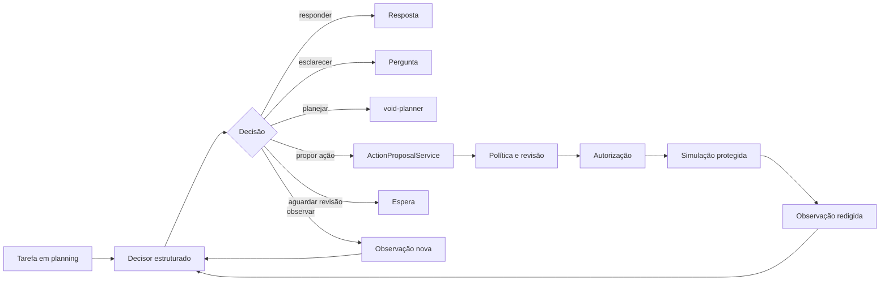

# Loop de decisão do VOID

O `DecisionLoopAgent` é a camada que transforma a interpretação de uma tarefa em um próximo passo estruturado. Ele complementa o `void-planner`; não substitui revisão, política, autorização nem o runtime de simulação.

## Objetivo

O agente precisa conseguir interpretar um objetivo, observar um resultado e escolher o próximo movimento sem que uma resposta de modelo possa chamar uma ferramenta por conta própria.

## Contrato

O `AgentDecider` recebe somente:

- `Task` em estado `planning`;
- observações estruturadas e minimizadas;
- número da iteração atual.

Ele retorna uma `AgentDecision` validada pelo loop:

| Decisão | Efeito do loop |
| --- | --- |
| `Respond` | devolve resposta local |
| `AskClarification` | solicita informação ao usuário |
| `ProposePlan` | delega ao `PlanningAgent` |
| `ProposeAction` | exige proposta/revisão separada |
| `WaitForReview` | encerra aguardando decisão humana |
| `Continue` | inclui uma observação e decide novamente |
| `Complete` | encerra a tarefa lógica |
| `Fail` | encerra com motivo controlado |

`ProposeAction` não emite autorização, não acessa `ToolRegistry` e não executa nada. O chamador confiável deve encaminhar a intenção para `ActionProposalService`; daí em diante continuam obrigatórios capacidade permitida, política atual, revisão humana, autorização vinculada e `GuardedSimulationRunner`.

## Máquina de estados explícita

Cada execução inicia em `deciding`. A decisão produz uma transição auditável para `responded`, `awaiting_clarification`, `planning`, `action_proposed`, `waiting_review`, `completed` ou `failed`. Todos esses estados são terminais para aquela execução. Não existe estado de execução de ferramenta.

`Continue` é a única transição intermediária: `deciding → observing → deciding`. Ela só é permitida quando há observação nova. Repetição encerra em `failed`; esgotar o teto de iterações encerra em `iteration_limit`. A auditoria registra somente origem, destino e razão da transição, sem conteúdo sensível.

O adapter atual é pequeno e sem dependência externa. `KStateMachine` permanece como referência para quando o VOID realmente precisar de estados hierárquicos, persistência de estado ou regiões paralelas. Assim, a API e as regras do domínio continuam pertencendo ao VOID.

## Limites e falha segura

- Há um teto explícito de iterações, oito por padrão.
- O loop para se tentar registrar novamente a mesma observação, sem avanço verificável.
- Observações iniciais maiores que o limite são rejeitadas.
- Textos, referências e metadados recebidos pelo loop são limitados; metadados aceitam apenas tipos simples, estruturas pequenas e números finitos.
- Toda decisão terminal e toda observação adicionada geram auditoria mínima, sem argumentos, destino, prompts ou identidade bruta.
- Uma falha do decisor é devolvida como `unable_to_decide_next_step`; ela não aciona fallback de ferramenta.

A persistência de checkpoints, memória local durável, cancelamento, deduplicação e recuperação após reinício continuam fora desta primeira implementação. O loop é deliberadamente pequeno: ele torna o raciocínio do agente testável antes de ampliar autonomia.

## Integração futura

Um decisor determinístico pode ser usado diretamente. Um modelo local ou remoto também pode ser conectado, desde que produza uma decisão estruturada validada antes de entrar no loop. Texto livre de modelo não deve ser tratado como comando de ferramenta.
