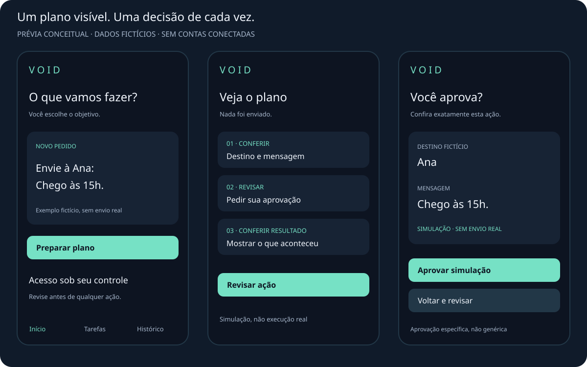

# Interface do VOID

**Protótipo visual preservado. Não é aplicativo Android implementado.** Dados fictícios, sem contas conectadas ou efeitos externos.

## Direção visual preservada

- Fundo `#0D1421`, cartões `#172334`, acento verde-menta `#76E1C5`.
- Texto principal `#F0F5FC` e secundário `#A8B8CD`.
- Hierarquia simples: objetivo, contexto e uma ação principal por etapa.
- Navegação proposta: Início, Tarefas e Histórico.
- Estados descritos por texto, não apenas cor.

São valores do protótipo existente, não design system implementado. Contraste de todos os estados, TalkBack, fonte ampliada, foco e áreas de toque ainda exigem validação.

## Seis telas, uma sequência compreensível

1. **Início:** entender objetivo e preparar plano sem execução imediata.
2. **Plano:** mostrar etapas e o que precisa ser revisado.
3. **Aprovação:** exibir ação e destino antes do consentimento.
4. **Execução:** progresso e cancelamento; parar não significa desfazer.
5. **Resultado:** sucesso, falha e efeito incerto separados; não repetir automaticamente ações sensíveis incertas.
6. **Histórico:** consultar decisões e resultados. Na demo, registros temporários; persistência é trabalho futuro.

[Experimentar as seis telas na demonstração publicada](https://pages.toqi.life/p/e55hzqwsn3cea6x5jateokml74). A demo HTML é uma ferramenta de exploração, não uma mudança de Android/Kotlin para web. Não é instalador nem implementação do runner. Recarregar apaga a sessão.

## Critérios futuros para Android

- UI dirigida por estado, lógica separada dos componentes visuais.
- Mudança de argumentos/destino exige nova aprovação.
- Evitar aprovação dupla e repetição indevida.
- Recuperar decisões importantes após encerramento do processo.
- Validar acessibilidade, orientação e ciclo de vida.
- Testar falha, timeout, cancelamento, aprovação expirada e efeitos incertos.

O teste isolado da lógica da demo passou na entrega anterior; a validação completa em navegador não concluiu. Não são evidências de validação do núcleo Kotlin, Android ou backend.
