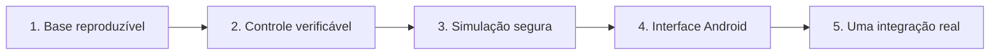

# Roadmap do VOID AI

> **Direção do projeto:** construir um agente de IA Android-first que interpreta objetivos, decide o próximo passo, planeja e propõe ações revisáveis. O VOID só avança para execução quando os controles, evidências e limites dessa etapa existirem e forem testados.

| Agora | Depois | Não ainda |
| --- | --- | --- |
| Propostas revisáveis | Simulações controladas | Conectores e contas reais |
| Estados auditáveis | Interface Android | Execução automática |
| PolicyGate restritivo | Aprovação verificável | Autorização por dados do cliente |

## Onde estamos

O núcleo atual já prova o fluxo de **planejamento**, não de execução:

- `void-planner` transforma uma tarefa em plano persistível com status `pending_review`.
- Tarefa, plano e etapa possuem estados explícitos, transições restritas e estados terminais.
- O `PolicyGate` avalia pedidos e **nega por padrão**. Ele não executa ferramentas.
- Contratos Kotlin, JSON Schema Draft-07 e serialização são verificados no CI.
- Propostas inválidas são rejeitadas antes de persistência: vazias, com IDs ausentes ou duplicados, textos obrigatórios vazios ou etapas com `tool`.

O que ainda **não** existe: aplicativo Android instalável, servidor, autenticação, aprovação verificável, executor, conector externo ou ferramenta real.

[Ver contratos](CONTRACTS.md) · [Ver segurança](SECURITY_REVIEW.md) · [Ver execuções da CI](https://github.com/wandersonsaint014-hue/VOID-IA-public/actions)

## Ordem de entrega

Cada fase depende da anterior. Não há atalho de planejamento para conector real, porque é justamente aí que projetos simpáticos ganham cicatrizes caras.

---

## 1. Base reproduzível

**Objetivo:** qualquer pessoa conseguir validar o núcleo sem adivinhar versões ou depender de configuração local implícita.

**Em andamento**

- [x] Executar testes Kotlin e schemas no GitHub Actions em checkout limpo.
- [x] Cobrir rejeições do planejador e impedir persistência de propostas inválidas.
- [x] Validar contratos de serialização e schemas offline.
- [ ] Adicionar Gradle Wrapper em alteração técnica isolada.
- [ ] Ampliar testes de compatibilidade Kotlin, JSON e OpenAPI.
- [ ] Revisar dependências sem prometer ausência total de vulnerabilidades.

**Pronto quando**

> Uma pessoa consegue clonar, executar verificações documentadas e reproduzir o resultado sem Gradle instalado globalmente.

**Não libera ainda:** aplicativo, servidor, autenticação ou execução de ferramentas.

---

## 2. Controle antes dos conectores

**Objetivo:** garantir que uma proposta seja rastreável e que nenhuma decisão do cliente possa virar autorização por acidente.

**Em andamento**

- [x] Produzir apenas planos revisáveis, auditáveis e sem ferramentas executáveis.
- [x] Formalizar estados de `Task`, `Plan` e `Step`.
- [x] Restringir transições inválidas e bloquear retorno de estados terminais.
- [x] Implementar `PolicyGate` como avaliador com negação por padrão.
- [x] Definir autorização verificável para o runtime simulado, vinculada a usuário, tarefa, ferramenta, ação, argumentos, destino, expiração e uso único.
- [x] Modelar proposta de ação, capacidade permitida, revisão humana e contrato transacional de emissão vinculada a `VerifiedPrincipal`.
- [x] Limitar profundidade, tamanho e tipos dos payloads no runtime simulado.
- [ ] Implementar autenticação real, armazenamento Android/servidor e emissão vinculada a identidade autenticada.
- [ ] Implementar revogação persistida e impedir repetição de efeitos sensíveis.
- [ ] Definir limites persistentes de tentativas, timeout, idempotência, concorrência e orçamento no runtime.
- [ ] Modelar falha confirmada, efeito incerto e cancelamento.
- [ ] Tratar conteúdo externo e resposta de modelo como dados não confiáveis.

**Pronto quando**

> Testes rejeitam ação não autorizada, aprovação alterada, expirada, revogada ou já consumida. Uma aprovação nunca supera uma decisão negativa da política.

**Regra inegociável:** aprovar uma proposta não executa nada.

---

## 3. Simulação segura

**Objetivo:** exercitar o ciclo completo de decisão e resultado sem tocar em contas, mensagens, pagamentos ou serviços externos.

**Planejado**

- [x] Criar um runner mínimo restrito a ferramentas simuladas.
- [x] Reavaliar `PolicyGate` imediatamente antes de cada efeito simulado.
- [x] Vincular a simulação a autorização de uso único, expiração, usuário, tarefa, ferramenta, ação, argumentos e destino.
- [ ] Persistir estado relevante e retomar com segurança após reinício.
- [ ] Registrar evidências sem expor segredos ou dados pessoais.
- [x] Limitar estrutura, tamanho e tipos das entradas antes do hash e da simulação.
- [ ] Limitar recursos persistentes, tempo, concorrência e tentativas.
- [ ] Testar cancelamento parcial, falha confirmada e efeito incerto.
- [ ] Criar testes de reconciliação e recuperação reproduzíveis.

**Pronto quando**

> Sucesso, falha, incerteza e interrupção possuem evidência, estado final compreensível e recuperação testada, tudo sem conta real.

**Não libera ainda:** conectores de terceiros ou efeitos fora do ambiente controlado.

---

## 4. Interface Android preservada

**Objetivo:** levar o fluxo seguro à interface sem esconder decisões importantes ou perder estado no ciclo de vida do aplicativo.

**Planejado**

- [ ] Implementar as seis telas da [direção visual](INTERFACE.md).
- [ ] Mostrar proposta, limites, estado e decisão de forma compreensível.
- [ ] Conectar a interface primeiro ao fluxo simulado.
- [ ] Preservar decisões e estado após reinício.
- [ ] Validar acessibilidade, leitura e navegação por teclado/tecnologias assistivas quando aplicável.
- [ ] Testar ciclo de vida Android e erros de rede simulados.

**Pronto quando**

> Uma pessoa percorre o fluxo completo de proposta a resultado simulado sem perder decisões importantes após reinício.

---

## 5. Uma integração real, sob controle

**Objetivo:** escolher **um** caso pequeno e reversível, provando controles antes de ampliar alcance.

**Só começa após as fases anteriores.**

- [ ] Selecionar uma ferramenta de baixo risco, escopo mínimo e recuperação possível.
- [ ] Implementar autenticação e autorização no servidor.
- [ ] Armazenar segredos fora de logs, auditoria e clientes.
- [ ] Exigir aprovação específica para ação, argumentos e destino.
- [ ] Criar limites, idempotência, timeout, revogação e observabilidade.
- [ ] Testar abuso, falha, incerteza, cancelamento e recuperação.
- [ ] Publicar instruções, limitações e evidências antes de distribuição.

**Pronto quando**

> Os limites são explícitos, a autorização é verificável, a recuperação foi testada e o mantenedor aprovou a distribuição.

---

## Próxima mudança recomendada

**Adicionar o Gradle Wrapper e implementar o armazenamento transacional Android da simulação.**

O Wrapper deixa a validação reproduzível. Em seguida, a prioridade é uma implementação local de `ActionReviewStore` e `ExecutionAuthorizationStore` com Room, consumo único atômico, expiração, revogação e recuperação após reinício. Nenhum conector real entra antes dessa prova.

## Como contribuir

Antes de abrir uma mudança, descreva:

1. o problema e o benefício;
2. o impacto nos contratos e estados;
3. os riscos, inclusive de segurança e privacidade;
4. como a alteração será testada;
5. o que a mudança **não** faz.

Frameworks multiagente, conectores e automações precisam justificar por que a solução simples não basta. Leia [CONTRIBUTING.md](../CONTRIBUTING.md), [pesquisa técnica](RESEARCH.md) e [revisão de segurança](SECURITY_REVIEW.md).
